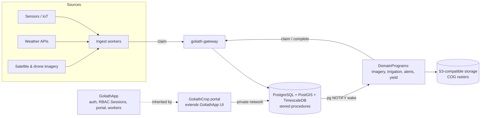

# GoliathCrop

GoliathApp specialization for crop management: farms, fields and plots, operations, inputs, sensors, weather, satellite and drone imagery, and research trials. Initial targets are a commercial farm and a research station.

Status: **planned**. This repository currently holds the catalog entry and the plan.

## Layout

| Path | Purpose |
| --- | --- |
| [`docs/plan.md`](docs/plan.md) | Full plan: domain model, ingestion, DomainPrograms, schema, RBAC, UI, roadmap, decisions |
| [`.goliath/product.json`](.goliath/product.json) | GoliathWeb catalog entry |

## Architecture

GoliathCrop inherits GoliathApp auth (`RBAC.Sessions`), the portal, the semantic registry (named requests + Exograph GraphQL/MCP) as the read API, typed `ActionSpec` actions, and workers that claim tasks through goliath-gateway, with Postgres pub/sub waking workers for event-triggered tasks. Geometry is PostGIS, readings are TimescaleDB, and rasters are COGs on S3-compatible storage.

See the [plan](docs/plan.md) for details.

## Related

| Product | Role |
| --- | --- |
| [GoliathApp](https://github.com/Goliath-Research/GoliathApp) | Platform (RBAC, portal shell, workers, DomainPrograms) |
| [GoliathOmics](https://github.com/Goliath-Research/GoliathOmics) | Sibling application; sample and plot links planned |
| [GoliathGroundStation](https://github.com/Goliath-Research/GoliathGroundStation) | Sibling application; possible drone/telemetry source |
| [GoliathWeb](https://github.com/Goliath-Research/GoliathWeb) | Public catalog (product page) |

## License

MIT — Copyright 2026 Goliath Research.
