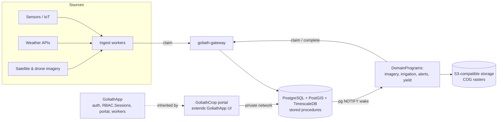

# GoliathCrop

GoliathApp specialization for crop management: farms, fields and plots, operations, inputs, sensors, weather, satellite and drone imagery, and research trials. Initial targets are a commercial farm and a research station.

Status: **in development** — Phase 2 MVP adds mobile portal domain views, `crop_obs` weather storage, Open-Meteo worker, and extended semantic reads/actions on top of Phase 1 core data.

## Layout

| Path | Purpose |
| --- | --- |
| [`docs/plan.md`](docs/plan.md) | Full plan: domain model, ingestion, DomainPrograms, schema, RBAC, UI, roadmap |
| [`docs/semantic-layer.md`](docs/semantic-layer.md) | Semantic namespace `crop`, export/seed, Phase 1 requests |
| [`src/goliath_crop/`](src/goliath_crop/) | Python package (semantic specs, actions, seed helpers) |
| [`database/schema/`](database/schema/) | Ordered SQL apply scripts (PostGIS + views + semantic functions) |
| [`portal/`](portal/) | Mobile-first domain views and FrameKey registry for the GoliathApp portal shell |
| [`scripts/apply_domain_schema.sh`](scripts/apply_domain_schema.sh) | Idempotent domain DDL apply (after GoliathApp platform schema) |
| [`domain_programs/`](domain_programs/) | DomainProgram notes (weather sync worker) |
| [`.goliath/product.json`](.goliath/product.json) | GoliathWeb catalog entry |

## Quick start (developers)

```bash
python -m pip install -e ".[dev]"
goliath-crop-semantic-export --catalog schemas/semantic/catalog.json \
  -o database/schema/portal_semantic_row_types.sql
pytest -q
```

After GoliathApp platform schema is on a database:

```bash
export PGHOST=... PGDATABASE=... PGUSER=... PGPASSWORD=...
./scripts/apply_domain_schema.sh
goliath-crop-seed-semantic
```

## Architecture



GoliathCrop inherits GoliathApp auth (`RBAC.Sessions`), the portal, the semantic registry (named requests + Exograph GraphQL/MCP) as the read API, typed `ActionSpec` actions, and workers that claim tasks through goliath-gateway, with Postgres pub/sub waking workers for event-triggered tasks. Geometry is PostGIS; TimescaleDB hypertables for readings are Phase 3; rasters are COGs on S3-compatible storage.

See the [plan](docs/plan.md) for details.

## Related

| Product | Role |
| --- | --- |
| [GoliathApp](https://github.com/Goliath-Research/GoliathApp) | Platform (RBAC, portal shell, workers, DomainPrograms) |
| [GoliathOmics](https://github.com/Goliath-Research/GoliathOmics) | Sibling application; sample and plot links planned |
| [GoliathGroundStation](https://github.com/Goliath-Research/GoliathGroundStation) | Sibling application; possible drone/telemetry source |
| [GoliathWeb](https://github.com/Goliath-Research/GoliathWeb) | Public catalog (product page) |

## License

MIT — Copyright 2026 Goliath Research.
