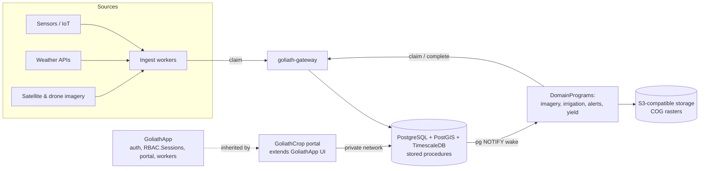

# GoliathCrop — Crop Management plan

Status: planned. GoliathCrop is a GoliathApp child application. GoliathApp knows nothing about GoliathCrop.

## Vision and users

One open-source system of record for what was planted where, what was done to it, what sensors and imagery say, and what it yielded, with workers that turn that data into irrigation schedules, yield forecasts, and alerts.

| User | Needs |
| --- | --- |
| Commercial farm (initial target) | Field records, operations log, inputs inventory, irrigation, alerts |
| Research station (initial target) | Trials, plots, treatments, replicates, observations, exports to GoliathOmics |
| Agronomists / advisors | Multi-farm view, scouting, sample results, recommendations |

## Architecture fit

| Concern | Decision |
| --- | --- |
| Parent | GoliathApp (does not reference GoliathCrop) |
| Auth | Inherit GoliathApp auth and `RBAC.Sessions` tokens; upgrade later if needed |
| API | PostgreSQL stored procedures; portal connects over a private network |
| Extensions | PostGIS (geometry), TimescaleDB (readings) |
| Rasters | COGs on S3-compatible long-term storage; footprints and metadata in PostGIS |
| Workers | Claim through goliath-gateway only (gateway is strictly for workers); Postgres pub/sub wakes event tasks |
| UI | Domain views in the GoliathApp portal (global UI pending) |
| Repo | Public, MIT, `.goliath/product.json` for GoliathWeb |

## Domain model

| Entity | Key facts |
| --- | --- |
| Farm / organization | Owner org, location, units, timezone |
| Field / plot | PostGIS polygon, area, soil type, parent field for trial plots |
| Crop / variety | Species, variety, maturity days, GDD base temperature |
| Season | Year/campaign; links field to a crop plan |
| Planting | Field × season × variety, date, density, seed lot |
| Operation | Irrigation, fertilization, spraying, harvest, tillage; date, rate, equipment, operator |
| Inputs inventory | Seed, fertilizer, chemicals; lots, stock, usage from operations |
| Sensor / device | Soil moisture, weather station, flow meter; readings time series |
| Weather | Observed and forecast per field; GDD, ET0 |
| Soil / tissue sample | Geo point, depth, lab results (N, P, K, pH, OM) |
| Imagery | Scene, source, date, NDVI/NDRE rasters, per-field stats |
| Scouting | Pest, disease, weed, severity, photo, geo point |
| Yield | Per field/plot totals and yield-monitor maps; moisture-adjusted |
| Trial | Design, treatments, replicates, plot observations |

## Data ingestion

- Sensors / IoT: MQTT or HTTP push to an ingest worker; batched inserts via stored procedure into TimescaleDB hypertables.
- Weather: free providers for the MVP (Open-Meteo, NOAA), pulled per field centroid; observed and forecast.
- Satellite: Sentinel-2 and Landsat via Copernicus / Element84 Earth Search STAC; cloud masking, NDVI/NDRE per field; outputs as COGs.
- Drone: uploaded orthomosaics converted to COGs on S3-compatible storage; processing task created on upload.
- Files: CSV and shapefile/GeoJSON import for fields, operations, lab results, yield-monitor exports.

## Workers and DomainPrograms

| Program | Activation | Trigger |
| --- | --- | --- |
| Weather sync | Claim | Scheduled backlog per field |
| Satellite fetch | Claim | Scheduled per field/season |
| Imagery processing (NDVI) | Wake + claim | Scene or drone upload inserted |
| Sensor ingest / QC | Wake + claim | Reading batch arrives |
| Irrigation scheduling | Wake + claim | New moisture/ET0 data; daily backlog |
| Yield prediction | Claim | Weekly backlog; season model runs |
| Alerts (frost, stress, pests) | Wake + claim | Threshold or anomaly event |
| Report / export | Claim | User request queued |

Pattern: a stored procedure inserts the task and issues `pg_notify`; idle workers wake, then own the task with a gateway claim. Backlog work is simply claimed.

Compute: MVP workers are CPU-only (index math, scheduling, alerts). ML yield models move to on-demand RunPod GPU workers later.

## Database schema sketch

| Schema | Key tables |
| --- | --- |
| `crop_core` | farms, fields (geometry), plots, seasons, crops, varieties, plantings |
| `crop_ops` | operations, operation_inputs, equipment, inventory_items, inventory_lots |
| `crop_obs` | devices, sensor_readings (TimescaleDB hypertable), weather_obs, weather_forecast |
| `crop_lab` | samples, sample_results |
| `crop_img` | raster_assets (S3 COG URI, footprint geometry, bands, CRS, acquired_at), imagery_scenes, field_index_stats |
| `crop_scout` | observations, pest_catalog, photos |
| `crop_yield` | yields, yield_maps, predictions |
| `crop_trial` | trials, treatments, replicates, plot_measurements |
| `crop_api` | stored procedures only; the portal's surface |

Row-level security by farm membership, keyed off the GoliathApp session. Required extensions: PostGIS and TimescaleDB.

## RBAC roles

| Role | Can |
| --- | --- |
| Farm owner | Everything on own farms; invite members |
| Farm manager | Edit fields, seasons, operations, inventory |
| Agronomist | Read assigned farms; scouting, samples, recommendations |
| Operator | Log operations and scouting from the field |
| Researcher | Trials, plots, measurements, exports |
| Viewer | Read-only |
| Worker (service) | Gateway claim scopes only |

## Portal UI views

1. Farm map: fields over a basemap with NDVI layer and alerts
2. Field detail: season timeline, operations, sensors, imagery history
3. Operations log and quick entry (web forms usable on a phone; offline app later)
4. Inventory: stock, lots, usage
5. Irrigation planner: recommended schedule vs soil moisture
6. Scouting: map pins, photos, severity
7. Yield and forecast dashboard
8. Trials: design grid, treatments, results

## Integrations

- GoliathOmics: link samples and plots to omics runs.
- GoliathGroundStation: drone/sensor telemetry and flight imagery source.
- GoliathAlign / GoliathExtractor: standalone utilities invoked by workers; unaware of GoliathApp.
- External: Open-Meteo, NOAA, Sentinel-2/Landsat STAC, ISOBUS/ADAPT files, John Deere Operations Center (later).

## Architecture diagram

## Roadmap

- **Phase 0 — Repo scaffold:** public repo, MIT, README, `.goliath/product.json` (planned, dependsOn goliathapp), GoliathWeb product page, this plan.
- **Phase 1 — Core data:** `crop_core`, `crop_ops`, `crop_trial` schemas on PostGIS + TimescaleDB, stored procedures, RLS, field/plot import (GeoJSON/shapefile).
- **Phase 2 — MVP (farm + research station):** farm map, field detail, operations log, inventory, trials (plots, treatments, replicates, observations); phone-usable web forms; Open-Meteo/NOAA weather worker; GoliathApp auth; $0 paid APIs; CPU workers.
- **Phase 3 — Sensing:** sensor ingest into hypertables with wake, Sentinel-2/Landsat NDVI to COGs, drone upload processing, alerts.
- **Phase 4 — Decisions and field app:** irrigation scheduling (FAO-56 water balance), scouting, offline/mobile field entry.
- **Phase 5 — ML and ecosystem:** yield prediction on on-demand RunPod GPUs, GoliathOmics/GroundStation links, ISOBUS/ADAPT, paid providers and auth upgrade if needed.

## Decisions

All confirmed by David Izada Rodriguez, November 2026.

| Topic | Decision |
| --- | --- |
| Initial targets | A commercial farm and a research station |
| Geometry | PostGIS |
| Readings | TimescaleDB over InfluxDB: free, runs as an extension in the same Postgres, so readings join with fields and stay behind the stored-procedure API; InfluxDB would add a second database and API |
| Neon support | Neon supports `timescaledb` on PG14–18, Apache-2 features only: hypertables, `time_bucket`, `drop_chunks`. No compression, continuous aggregates, or retention jobs. Fallback: self-hosted Postgres + full TimescaleDB, or plain partitioned tables (`pg_partman`) with materialized views. Source: https://neon.com/docs/extensions/timescaledb |
| Rasters | COGs on S3-compatible long-term storage; `raster_assets` table in PostGIS holds URI, footprint, and metadata |
| Auth | Inherit GoliathApp auth; upgrade later if needed |
| Offline/mobile field entry | After the MVP; MVP web field forms must work on a phone |
| Weather/imagery providers | Free first: Open-Meteo, NOAA, Sentinel-2 via Copernicus/Element84 STAC, Landsat; paid budget $0 for the MVP |
| Trials/research | Core MVP module (plots, treatments, replicates, observations) |
| Compute | CPU-only workers to start; on-demand RunPod GPUs later for ML |
