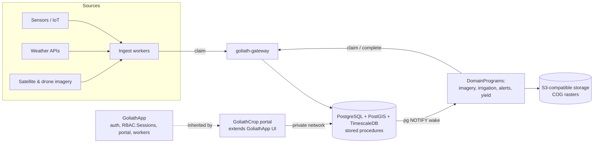

# GoliathCrop — Crop Management plan

Status: Phase 5 landed — yield prediction, ecosystem integration hooks, ISOBUS/ADAPT stubs. Planned roadmap complete through Phase 5.

## Vision and users

One open-source system of record for what was planted where, what was done to it, what sensors and imagery say, and what it yielded, with workers that turn that data into irrigation schedules, yield forecasts, and alerts.

| User | Needs |
| --- | --- |
| Commercial farm (initial target) | Field records, operations log, inputs inventory, irrigation, alerts |
| Research station (initial target) | Trials, plots, treatments, replicates, observations, exports to GoliathOmics |
| Agronomists / advisors | Multi-farm view, scouting, sample results, recommendations |

## Architecture fit

| Concern | Decision |
| --- | --- |
| Parent | GoliathApp (does not reference GoliathCrop) |
| Auth | Inherit GoliathApp auth and `RBAC.Sessions` tokens; upgrade later if needed |
| API | GoliathApp semantic registry (`portal.sp_run_semantic_request`, Exograph GraphQL/MCP) for reads; `ActionSpec` actions via the gateway for writes |
| Extensions | PostGIS (geometry), TimescaleDB (readings) |
| Rasters | COGs on S3-compatible long-term storage; footprints and metadata in PostGIS |
| Workers | Claim through goliath-gateway only (gateway is strictly for workers); Postgres pub/sub wakes event tasks |
| UI | Domain views in the GoliathApp portal (global UI pending) |
| Repo | Public, MIT, `.goliath/product.json` for GoliathWeb |

## Semantic layer

Raw tables are an internal detail. Users, the portal, and agents see **GoliathCrop** through GoliathApp's semantic registry ([semantic layer](https://goliath-research.github.io/GoliathApp/semantic-layer/), [semantic extensions](https://goliath-research.github.io/GoliathApp/semantic-extensions/)), the same pattern as GoliathOmics.

- **Namespace:** `crop` (row in `portal.semantic_namespace`; GoliathApp owns `core` and `engine`).
- **Registration:** Python `SemanticEntitySpec` / `SemanticRequestSpec` (`goliath_app.semantic.spec`) → `goliath-semantic-export` (Pydantic row models, `portal_semantic_row_types.sql`, `schemas/semantic/catalog.json`) → release seeder calling `portal.sp_semantic_register_entity`, `portal.sp_semantic_register_attribute`, `portal.sp_semantic_register_request`.
- **Reads:** every read is a named request run by `portal.sp_run_semantic_request` (RBAC permission + organization scope), via `goliath_app.portal.PortalClient` or the Exograph GraphQL/MCP façade.

### Entities

| Code | Display name | Key attributes | Backing (`storage_relation` / Meta class) |
| --- | --- | --- | --- |
| `crop.farm` | Farm | name, organization, location, timezone, units | view `crop_core.v_farm` |
| `crop.field` | Field | farm, name, area_ha, soil_type, geometry (GeoJSON) | view `crop_core.v_field` |
| `crop.plot` | Trial plot | field, trial, code, geometry | view `crop_core.v_plot` |
| `crop.season` | Season | farm, year, campaign, status | view `crop_core.v_season` |
| `crop.planting` | Planting | field, season, variety, sown_on, density, seed_lot | view `crop_core.v_planting` |
| `crop.variety` | Crop variety | species, variety, maturity_days, gdd_base_c | view `crop_core.v_variety` |
| `crop.operation` | Field operation | planting, kind, performed_on, rate, equipment, operator | view `crop_ops.v_operation` |
| `crop.input_lot` | Input lot | item, lot, on_hand, unit | view `crop_ops.v_input_lot` |
| `crop.sensor` | Sensor | farm, kind, field, last_reading_at | view `crop_obs.v_device` |
| `crop.reading` | Sensor reading | sensor, ts, metric, value | function `crop_obs.fn_readings_window` (hypertable) |
| `crop.weather` | Weather | field, date, tmin, tmax, precip, gdd, et0 | view `crop_obs.v_weather_daily` |
| `crop.sample` | Soil / tissue sample | field, geo point, depth, kind (soil/tissue), collected_on, lab results (N, P, K, pH, OM) | view `crop_lab.v_sample` (joins samples, sample_results) |
| `crop.scene` | Imagery scene | field, acquired_at, source, index_stats | view `crop_img.v_scene` |
| `crop.scouting` | Scouting observation | field, observed_at, pest, severity, photo | view `crop_scout.v_observation` |
| `crop.yield` | Yield | planting, measured_t_ha, predicted_t_ha | view `crop_yield.v_yield` |
| `crop.trial` | Trial | season, design, treatments, replicates | view `crop_trial.v_trial` |

### Named requests

| `request_code` | Entity | Params | `required_permission` | Target |
| --- | --- | --- | --- | --- |
| `crop.field.list_by_farm` | `crop.field` | farm_id, season_id? | `crop.field.read` | view `crop_core.v_field` + filter template |
| `crop.planting.list_by_season` | `crop.planting` | season_id, field_id? | `crop.planting.read` | view |
| `crop.operation.list` | `crop.operation` | planting_id?, kind?, from, to | `crop.operation.read` | view |
| `crop.reading.window` | `crop.reading` | sensor_id, from, to, bucket | `crop.sensor.read` | function `crop_obs.fn_readings_window` |
| `crop.weather.daily` | `crop.weather` | field_id, from, to | `crop.weather.read` | view |
| `crop.sample.list_by_field` | `crop.sample` | field_id, kind?, from?, to? | `crop.sample.read` | view `crop_lab.v_sample` |
| `crop.scene.list_by_field` | `crop.scene` | field_id, from?, to? | `crop.imagery.read` | view |
| `crop.yield.by_season` | `crop.yield` | season_id | `crop.yield.read` | view |
| `crop.trial.results` | `crop.trial` | trial_id | `crop.trial.read` | function `crop_trial.fn_trial_results` |
| `crop.scouting.list_by_field` | `crop.scouting` | field_id, from?, to? | `crop.scouting.read` | function `crop_scout.fn_semantic_list_by_field` |
| `crop.irrigation.schedule_by_field` | `crop.irrigation` | field_id, from?, to? | `crop.irrigation.read` | function `crop_irr.fn_semantic_schedule_by_field` |

### Example entity spec

```python
from goliath_app.semantic.spec import SemanticAttributeSpec, SemanticEntitySpec, SemanticRequestSpec

FIELD_ENTITY = SemanticEntitySpec(
    namespace="crop",
    code="field",
    display_name="Field",
    description="A managed field or trial plot parent with its boundary.",
    schema_version="1",
    row_model=FieldRow,
    storage_relation="crop_core.v_field",
    attributes=(
        SemanticAttributeSpec(code="field_id", column_name="id", json_type="integer", role="key"),
        SemanticAttributeSpec(code="farm_id", column_name="farm_id", json_type="integer", role="filter", filterable_ops=("eq",)),
        SemanticAttributeSpec(code="name", column_name="name", json_type="string", role="label", filterable_ops=("ilike",)),
        SemanticAttributeSpec(code="area_ha", column_name="area_ha", json_type="number", role="measure", filterable_ops=("gte", "lte")),
        SemanticAttributeSpec(code="soil_type", column_name="soil_type", json_type="string", role="attribute", filterable_ops=("eq", "in")),
    ),
)

FIELD_LIST = SemanticRequestSpec(
    request_code="crop.field.list_by_farm",
    version="1",
    namespace="crop",
    entity_code="field",
    target_kind="view",
    target_name="crop_core.v_field",
    params_model=FieldListParams,
    result_row_model=FieldRow,
    required_permission="crop.field.read",
    max_rows=500,
)
```

## Action layer

Business operations are typed `ActionSpec` rows (`goliath_app.actions.spec`), published through the `goliath.action_catalogs` entry point and synced into `wf.workflow_action` by the release (`seed_action_catalog.py --use-db`). Levels: `engine` = low-level workflow steps (GoliathApp), `core` = GoliathApp core-entity actions, `domain` = GoliathCrop business actions. Every user-facing action uses `exposure=ActionExposure.RBAC` and names its `entity_code`; internal helper steps use `ActionExposure.HIDDEN`.

| `action_name` | Level | `entity_code` | Exposure | `required_permission` | Capability |
| --- | --- | --- | --- | --- | --- |
| `crop.field.import_boundaries` | domain | `crop.field` | RBAC | `crop.field.write` | `crop.ingest` |
| `crop.operation.record` | domain | `crop.operation` | RBAC | `crop.operation.write` | `crop.ops` |
| `crop.sensor.ingest_batch` | domain | `crop.reading` | HIDDEN | — | `crop.ingest` |
| `crop.weather.refresh` | domain | `crop.weather` | HIDDEN | — | `crop.weather` |
| `crop.sample.import_lab_results` | domain | `crop.sample` | RBAC | `crop.sample.write` | `crop.ingest` |
| `crop.scene.fetch_and_index` | domain | `crop.scene` | RBAC | `crop.imagery.write` | `crop.imagery` |
| `crop.yield.predict` | domain | `crop.yield` | RBAC | `crop.yield.write` | `crop.model` |
| `crop.trial.analyze` | domain | `crop.trial` | RBAC | `crop.trial.write` | `crop.model` |
| `crop.scouting.record` | domain | `crop.scouting` | RBAC | `crop.scouting.write` | `crop.ops` |
| `crop.irrigation.schedule` | domain | `crop.irrigation` | HIDDEN | — | `crop.irrigation` |

### Example ActionSpec

```python
from goliath_app.actions.spec import ActionExposure, ActionLevel, ActionSpec

PREDICT = ActionSpec(
    action_name="crop.yield.predict",
    namespace="crop",
    level=ActionLevel.DOMAIN,
    entity_code="yield",
    display_name="Predict yield",
    description="Run the yield model for a season and store predictions.",
    exposure=ActionExposure.RBAC,
    required_permission="crop.yield.write",
    input_model=YieldPredictInput,
    output_model=YieldPredictOutput,
    schema_version="1",
    capability="crop.model",
    tool="crop-yield-model",
)
```

```toml
# pyproject.toml
[project.entry-points."goliath.action_catalogs"]
crop = "goliath_crop.actions.catalog:ACTIONS"
```

## NavTree extension

GoliathCrop **adds** nodes to `portal."NavTree"` with `portal.sp_nav_register_node(p_parent_id, p_caption, p_seq, p_info_id, p_node_path, p_sort_path)` and grants them in `portal."Role2Node"` (`ScopeId`, `RoleId`, `NodeId`). It never updates or deletes GoliathApp foundation nodes (home, organizations, users and roles, workflows, admin); it only attaches a top-level **Crop** node beside them and children under it. Captions stay within `varchar(50)`. Each leaf's `InfoID` points to the entity, request, or action it opens.

| Node path | Opens | Roles (`Role2Node`) |
| --- | --- | --- |
| Crop | group node beside foundation menus | all crop roles |
| Crop › Farms & fields | `crop.field.list_by_farm` | owner, agronomist, operator, viewer |
| Crop › Seasons & plantings | `crop.planting.list_by_season` | owner, agronomist, operator |
| Crop › Operations | `crop.operation.list`; action `crop.operation.record` | owner, agronomist, operator |
| Crop › Sensors & weather | `crop.reading.window`, `crop.weather.daily` | owner, agronomist, viewer |
| Crop › Soil & tissue samples | `crop.sample.list_by_field`; action `crop.sample.import_lab_results` | owner, agronomist |
| Crop › Imagery | `crop.scene.list_by_field`; action `crop.scene.fetch_and_index` | owner, agronomist |
| Crop › Yield | `crop.yield.by_season`; action `crop.yield.predict` | owner, agronomist |
| Crop › Scouting | `crop.scouting.list_by_field`; action `crop.scouting.record` | owner, agronomist, operator |
| Crop › Irrigation planner | `crop.irrigation.schedule_by_field` | owner, agronomist, operator |
| Crop › Field entry | phone web forms (`crop.field.entry`) | owner, agronomist, operator |
| Crop › Trials | `crop.trial.results`; action `crop.trial.analyze` | owner, researcher |

Role2Node rows are scoped per organization (`ScopeId`); the release seeder inserts them idempotently after the nodes exist. Foundation menus remain exactly as GoliathApp ships them.

## Reuse of GoliathApp

| Concern | Comes from GoliathApp | GoliathCrop adds |
| --- | --- | --- |
| Organizations and tenancy | `portal."Organizations"`, `portal.fn_semantic_user_organization_ids` | Farm is a child of an organization (`crop.farm.organization_id`); no separate org table |
| RBAC | `RBAC` roles, `"RBAC"."UserRoleGrants"`, `"RBAC"."Role_Permissions"`, sessions | `crop.*` permissions and role bundles |
| Audit and e-signature | Platform append-only audit and signature service | Domain meanings for signatures |
| Read API | `portal.sp_run_semantic_request`, `PortalClient`, Exograph GraphQL + optional MCP (`goliath_portal` role, read-only) | Registry rows only |
| Writes | REST gateway → `wf.sp_*` / `portal.sp_*` ops and `ActionSpec` actions | Domain actions |

There is no per-app "stored procedures are the API" surface: internal domain procedures exist only as `target_name` of semantic requests or as action handlers.

## Data ingestion

- Sensors / IoT: MQTT or HTTP push to an ingest worker; batched inserts via stored procedure into TimescaleDB hypertables.
- Weather: free providers for the MVP (Open-Meteo, NOAA), pulled per field centroid; observed and forecast.
- Satellite: Sentinel-2 and Landsat via Copernicus / Element84 Earth Search STAC; cloud masking, NDVI/NDRE per field; outputs as COGs.
- Drone: uploaded orthomosaics converted to COGs on S3-compatible storage; processing task created on upload.
- Files: CSV and shapefile/GeoJSON import for fields, operations, lab results, yield-monitor exports.

## Workers and DomainPrograms

| Program | Activation | Trigger |
| --- | --- | --- |
| Weather sync | Claim | Scheduled backlog per field |
| Satellite fetch | Claim | Scheduled per field/season |
| Imagery processing (NDVI) | Wake + claim | Scene or drone upload inserted |
| Sensor ingest / QC | Wake + claim | Reading batch arrives |
| Irrigation scheduling | Wake + claim | New moisture/ET0 data; daily backlog |
| Yield prediction | Claim | Weekly backlog; season model runs |
| Alerts (frost, stress, pests) | Wake + claim | Threshold or anomaly event |
| Report / export | Claim | User request queued |

Pattern: a stored procedure inserts the task and issues `pg_notify`; idle workers wake, then own the task with a gateway claim. Backlog work is simply claimed.

Compute: MVP workers are CPU-only (index math, scheduling, alerts). ML yield models move to on-demand RunPod GPU workers later.

## RBAC roles

| Role | Can |
| --- | --- |
| Farm owner | Everything on own farms; invite members |
| Farm manager | Edit fields, seasons, operations, inventory |
| Agronomist | Read assigned farms; scouting, samples, recommendations |
| Operator | Log operations and scouting from the field |
| Researcher | Trials, plots, measurements, exports |
| Viewer | Read-only |
| Worker (service) | Gateway claim scopes only |

## Portal UI views

1. Farm map: fields over a basemap with NDVI layer and alerts
2. Field detail: season timeline, operations, sensors, imagery history
3. Operations log and quick entry (web forms usable on a phone; offline app later)
4. Inventory: stock, lots, usage
5. Irrigation planner: recommended schedule vs soil moisture
6. Scouting: map pins, photos, severity
7. Yield and forecast dashboard
8. Trials: design grid, treatments, results

## Integrations

- GoliathOmics: link samples and plots to omics runs.
- GoliathGroundStation: drone/sensor telemetry and flight imagery source.
- GoliathAlign / GoliathExtractor: standalone utilities invoked by workers; unaware of GoliathApp.
- External: Open-Meteo, NOAA, Sentinel-2/Landsat STAC, ISOBUS/ADAPT files, John Deere Operations Center (later).

## Architecture diagram



## Roadmap

- **Phase 0 — Repo scaffold:** public repo, MIT, README, `.goliath/product.json` (planned, dependsOn goliathapp), GoliathWeb product page, this plan.
- **Phase 1 — Core data:** `crop_core`, `crop_ops`, `crop_trial` schemas on PostGIS + TimescaleDB, semantic registry + action catalog, RLS, field/plot import (GeoJSON/shapefile).
- **Phase 2 — MVP (farm + research station):** farm map, field detail, operations log, inventory, trials (plots, treatments, replicates, observations); phone-usable web forms; Open-Meteo/NOAA weather worker; GoliathApp auth; $0 paid APIs; CPU workers.
- **Phase 3 — Sensing:** sensor ingest into hypertables with wake, Sentinel-2/Landsat NDVI to COGs, drone upload processing, alerts.
- **Phase 4 — Decisions and field app:** irrigation scheduling (FAO-56 water balance), scouting, phone-usable web field forms (offline native app after MVP). **In progress / landing on main.**
- **Phase 5 — ML and ecosystem:** yield prediction on on-demand RunPod GPUs, GoliathOmics/GroundStation links, ISOBUS/ADAPT, paid providers and auth upgrade if needed. **Landed:** `crop_yield` + `crop.yield.predict`, integration actions/reads, machine import stubs; see [integrations.md](integrations.md).

## Decisions

All confirmed by David Izada Rodriguez, November 2026.

| Topic | Decision |
| --- | --- |
| Initial targets | A commercial farm and a research station |
| Geometry | PostGIS |
| Readings | TimescaleDB over InfluxDB: free, runs as an extension in the same Postgres, so readings join with fields and stay behind the stored-procedure API; InfluxDB would add a second database and API |
| Neon support | Neon supports `timescaledb` on PG14–18, Apache-2 features only: hypertables, `time_bucket`, `drop_chunks`. No compression, continuous aggregates, or retention jobs. Fallback: self-hosted Postgres + full TimescaleDB, or plain partitioned tables (`pg_partman`) with materialized views. Source: https://neon.com/docs/extensions/timescaledb |
| Rasters | COGs on S3-compatible long-term storage; `raster_assets` table in PostGIS holds URI, footprint, and metadata |
| Auth | Inherit GoliathApp auth; upgrade later if needed |
| Offline/mobile field entry | After the MVP; MVP web field forms must work on a phone |
| Weather/imagery providers | Free first: Open-Meteo, NOAA, Sentinel-2 via Copernicus/Element84 STAC, Landsat; paid budget $0 for the MVP |
| Trials/research | Core MVP module (plots, treatments, replicates, observations) |
| Compute | CPU-only workers to start; on-demand RunPod GPUs later for ML |

## Appendix: physical mapping (internal)

These schemas back the semantic entities above. They are not a public API: the portal, Exograph, and agents reach them only through registered semantic requests and `ActionSpec` actions.

| Schema | Key tables |
| --- | --- |
| `crop_core` | farms, fields (geometry), plots, seasons, crops, varieties, plantings |
| `crop_ops` | operations, operation_inputs, equipment, inventory_items, inventory_lots |
| `crop_obs` | devices, sensor_readings (TimescaleDB hypertable), weather_obs, weather_forecast |
| `crop_lab` | samples, sample_results |
| `crop_img` | raster_assets (S3 COG URI, footprint geometry, bands, CRS, acquired_at), imagery_scenes, field_index_stats |
| `crop_scout` | observations, pest_catalog, photos |
| `crop_yield` | yields, yield_maps, predictions |
| `crop_trial` | trials, treatments, replicates, plot_measurements |

Row-level security by farm membership, keyed off the GoliathApp session. Required extensions: PostGIS and TimescaleDB.
